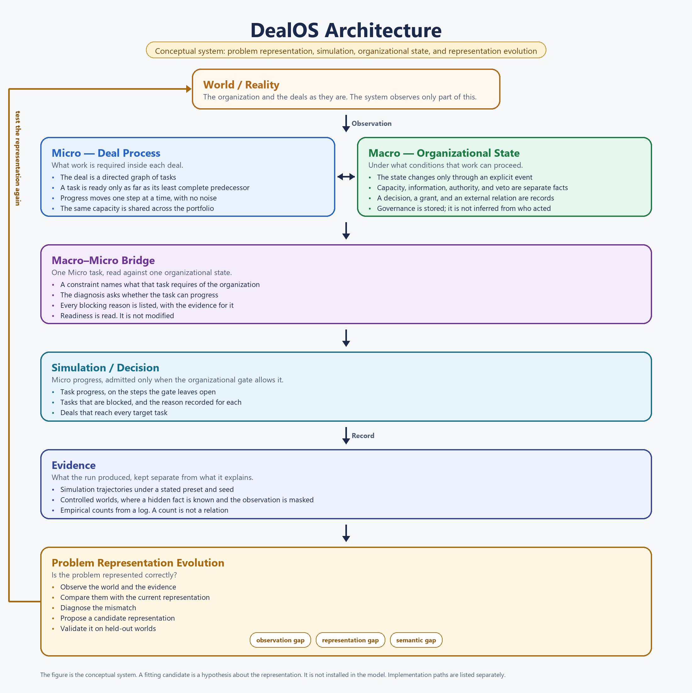

# DealOs

Deterministic simulation of an enterprise sales portfolio as a capacity-constrained sequential decision problem.

V1 is an experimental environment. It exists so we can ask whether this mathematical formulation is meaningful. It does not show that any allocation rule is better than another.

## Business problem

An enterprise deal is not a linear funnel stage. Closing it requires parallel work: commercial, technical, legal, security, procurement, and executive approval. Those work packages depend on each other, and the same people are shared across the portfolio.

The decision, each business day, is how to allocate scarce capacity across the tasks that can currently make progress. The quantity we record is how many deals reach their target tasks. Deal value, deadlines, and other objectives are deliberately absent until this version can show that the simpler objective is well posed.

## Mathematical formulation

Deal `i` is a directed acyclic graph

```
G_i = (V_i, E_i)
```

`V_i` is the set of tasks. `E_i` is the set of AND precedence edges. A task with several predecessors can start new work only to the extent that the least complete predecessor allows.

Task progress:

```
x_ij(t) ∈ [0, 1]
```

Readiness:

```
Pred_ij = {k : (k, j) ∈ E_i}

Ready_ij = 1                         if Pred_ij is empty
Ready_ij = min_{k ∈ Pred_ij} x_ik    otherwise
```

Readiness multiplies **new** progress. The simulator does not enforce `x_ij ≤ Ready_ij`. A task may already be ahead of a predecessor. That progress is kept; it just does not increase while readiness is zero.

One-step dynamics, with no noise:

```
Δx_ij(t) = φ_ij * Ready_ij(x_i(t)) * Σ_r α_jr q_jr a_ijr(t)

x_ij(t+1) = min(1, x_ij(t) + Δx_ij(t))
```

`φ_ij` is a task feasibility factor, `α_jr` is the productivity of resource `r` on task `j`, and `q_jr` is suitability. In V1 all three are constants drawn with the scenario.

An allocation is a fraction of one resource unit:

```
a_ijr(t) ∈ [0, 1]
Σ_i Σ_j a_ijr(t) ≤ C_r(t)
```

`C_r` may be larger than 1 when several people share a role. V1 uses a constant `C_r`, stored on the state so a later schedule can replace it. An action that breaks the bound is rejected. The simulator does not clip it.

Deal `i` has target tasks `Target_i`.

```
y_i = 1  iff  x_ij = 1 for every j ∈ Target_i
```

The recorded objective is `Σ_i y_i`. There are no deal weights.

Time is discrete: `t = 0, 1, ..., T`. One step is one business day. There is no calendar.

At the moment of decision, readiness and the three parameter families are known, so a single step is linear in `a`. The multi-day problem is not linear, because tomorrow's readiness depends on today's progress. That is why V1 does not ship a solver.

Completion uses an explicit tolerance (`1e-9` by default) and snaps a task to progress `1` once it is within that tolerance. A task is blocked when it is incomplete and readiness is at or below `blocked_readiness_threshold` (default `0`). Partial predecessor progress produces partial new progress, which is the formula above, not a hard gate at 1.

## Simulation model

Static objects live on `Scenario`: graphs, targets, resources, capacities, `φ`, `α`, `q`, horizon, and the config that states the assumptions.

Dynamic objects live on `PortfolioState`, returned by `get_state()` as a deep copy:

- elapsed day `time`
- `task_progress`
- `task_status` in `{not_started, blocked, in_progress, completed}`
- `capacities`
- current `allocations`
- `completed_deals` and `deal_complete` (`y_i`)
- `blocked_tasks`
- `ready_since`, the day an incomplete task first became unblocked
- completion days for tasks and deals

Within one step, every task is updated from the progress vector at the start of the day. A successor does not benefit from predecessor progress earned on that same day.

Progress is monotone. V1 has no rework, decay, or re-blocking. Allocation to a task that is already complete still consumes capacity and does not change progress. The step record reports that quantity as waste. Policies are written to avoid it.

`is_done()` is true when every deal is complete, when `t = T`, or both. Both reasons are stored.

`SalesEnvironment` does not draw random numbers. A policy that needs randomness owns its own seeded generator.

## Architecture



The Micro layers depend on the action, not on which policy built it. Replacing a policy does not require a simulator change.

`org/operating` is the only organizational model. Its state is a value: capacity pools, information items, decisions, authority grants, delegations, vetoes, governance bodies, and external relations. Every change is an explicit event. A `TaskConstraint` names the pools, information, decision, and external relation a single Micro task requires, and `bridge.diagnose` reports whether that task is organizationally eligible, with the first blocker and the full list of blockers. The bridge reads Micro readiness; it does not change it. A predecessor-blocked task and an organizationally ineligible task remain different facts.

`macro_world` and `problem_evolution` do not touch the simulator. They ask whether a representation can express a fact, whether an event stream can recover it, and whether a proposed primitive survives held-out worlds. Co-occurrence, event order, activity names, and resource changes do not create relations anywhere in the repository.

`analysis/bpi17` reads the public log and reports counts. It imports none of the other layers.

## Experiment index

Each report in `docs/` is the whole experiment: question, setup, tables, and the recorded result. The line quoted here is the result the report records, not a summary of what it means.

| Report | Question | Recorded result |
| --- | --- | --- |
| `v2_representation.md` | Task type versus task occurrence; readiness versus lifecycle versus eligibility | Occurrence decisions fixed; `declare_ready` is a test switch, not a BPI17 reading |
| `blockage_diagnosis.md` | Where a deal is blocked (Micro) and why (Macro), in one model | No new primitive added; capacity is one Micro reading; information, authority, cross-organization stay gaps |
| `bpi17_validation_report.md` | How the BPI17 log maps onto the Micro and Macro representations | Facts, inferences, and hypotheses kept apart; representation gaps and candidate extensions listed, none installed |
| `bpi17_micro_experiment_summary.md` | Do births, resource continuity, and lifecycle mixes call for a simulator change | MICRO SHOULD REMAIN FROZEN |
| `bpi17_occurrence_birth.md`, `_birth_context.md`, `_lifecycle.md`, `_resource_continuity.md` | Counts behind the micro summary | Descriptive tables; no edge written, readiness unchanged |
| `bpi17_macro_experiment.md` | What `org:resource` lets us observe across cases | MACRO CANDIDATE IDENTIFIED (collected in `bpi17_reports.md`) |
| `bpi17_resource_identifier_experiment.md` | R0 versus R0 plus a persistent resource identifier | MACRO PRIMITIVE JUSTIFIED |
| `macro_operating_model.md` | Definition of the organizational state and its transition function | Model definition; no experiment |
| `macro_state_experiment.md` | Does one explicit event produce the next organizational state | MACRO STATE IMPLEMENTED |
| `macro_world_experiment.md` | Seven ground-truth worlds under observation masks; representable versus recoverable | MACRO WORLD VALIDATED |
| `macro_relation_experiment.md` | Fifteen relation scenarios; which hidden facts recover through their own fields | FIVE HIDDEN FACTS RECOVERABLE WHEN THEIR OWN FIELDS ARE EXPOSED |
| `macro_micro_integration_experiment.md` | Same Micro readiness, different Macro state, different outcome | MACRO MICRO COUPLING DEMONSTRATED (18/18 rows, 0 invariant failures) |
| `macro_micro_multiconstraint_experiment.md` | Four simultaneous constraints released one event at a time, two orderings | Each event removes only its own blocker; progress waits for the last one |
| `representation_gap_experiment.md` | Observation gap, representation gap, semantic gap, no gap on one ready task | Four scenarios classified; `UnmodeledConstraint` accepted as a slot, not installed |
| `representation_gap_ground_truth_experiment.md` | A hidden rule the gate has no field for; candidates fitted on G1-G3, scored on G4-G6 and a 48-world grid | DutyExclusion supported; DecisionQuorum fits the named worlds but fails grid rows where the prior actor is outside the holder set |

## Current limitations

- The Micro simulator is deterministic and AND-only. Parameters `φ`, `α`, `q` are synthetic, capacities are constant, there is no rework, decay, deal value, or calendar.
- No policy ranking is claimed anywhere. `OptimizationPolicy` documents a linear program and raises `NotImplementedError`.
- The Macro operating model is a definition exercised on hand-built states. No organizational state in the repository was recovered from a real organization or a real deal log.
- The Macro-Micro bridge diagnoses one task at a time through a `TaskConstraint`. It does not schedule, allocate, or feed back into readiness.
- Representation-gap results are about synthetic worlds whose hidden rule the experiment itself defined. Candidate acceptance is not evidence that the primitive exists outside those worlds, and no candidate is installed in the operating model.
- The BPI17 analysis reports counts. It does not infer handoffs, ownership, authority, or dependencies from resource ids, event order, or activity names.
- The problem-evolution engine proposes and scores structural mutations as candidate representations. The parent representation and the simulator are not changed by a run.

Presets change only `GeneratorConfig`: number of deals, horizon, capacities, optional-task drop rate, extra AND-edge probability, and which task types are protected from dropping. They do not fork the update rule.

| Preset | What it changes |
| --- | --- |
| `balanced` | Moderate headcount, shallow extra dependencies |
| `legal_bottleneck` | Legal capacity `0.5`, legal tasks kept |
| `technical_bottleneck` | Sales engineer and solutions architect capacity `0.5`, technical tasks kept |
| `resource_constrained` | Eight deals, every capacity `0.5` |
| `dependency_heavy` | Full template, high probability of extra AND edges |

Synthetic graphs are built from a fixed work-package template (discovery through signature), not from external data. Unsuitable resource-task pairs get `q = 0`.

## Baseline policies

All runnable policies implement `select_action(state, scenario) -> AllocationAction`.

- **RandomPolicy.** Shuffles currently eligible tasks and assigns random feasible fractions of remaining capacity. Seeded, and independent of the simulator.
- **FIFOPolicy.** Eligible tasks that have been ready longest are filled first. Ties break by deal id, then task id.
- **BottleneckPolicy.** Eligible tasks are ordered by how many incomplete descendants they block, then by longest wait, then by id. The same greedy fill is used.
- **OptimizationPolicy.** Documents the one-step linear program and the terminal objective. `select_action` raises `NotImplementedError`. The experiment runner does not call it.

Eligible means incomplete and readiness strictly above the blockage threshold. The greedy fill uses resources in decreasing `α · q` order, never assigns more than `1` to a pair, and never assigns more than remaining capacity.

## Evaluation

```bash
python -m dealos.experiments --preset balanced --seeds 0 1 2
```

For each seed the runner builds one scenario and rolls out each runnable policy until the episode ends. It records, per run:

- completed deals (`Σ y_i`)
- completion day of each deal, or none if unfinished
- total task progress
- blocked task-steps
- mean resource utilization
- mean number of active deals
- throughput: deals newly completed during the run, divided by steps taken
- steps used and why the run stopped

Across seeds it reports count, mean, sample standard deviation, min, and max. The text table prints means. It does not declare a winner. A difference in that table is a description of those runs, not evidence that a policy is better.

## What V1 can and cannot conclude

V1 can check whether the objects in the formulation are implementable, whether the constraints fire, and whether two policies produce different trajectories under a stated preset and seed.

V1 cannot conclude that bottleneck allocation outperforms FIFO, that an optimizer would help, or that the objective `Σ y_i` is the right business objective. Those are empirical questions this code is meant to host, not answer in advance. No result in the repository claims a ranking.

Parameters `φ`, `α`, and `q` are synthetic. Capacities are constant. Dependencies are AND-only. There is no stochastic delay, no rework, and no deal value.

## Tests

```bash
pip install -e ".[dev]"
python -m pytest -q
```

One module per layer, 191 tests:

| Module | Covers |
| --- | --- |
| `tests/test_micro_core.py` | graph construction, AND readiness, dynamics, capacity rejection, occurrences and lifecycle, policies |
| `tests/test_generation.py` | generator, preset structure, controlled edits, horizon sweep |
| `tests/test_diagnostics.py` | chain diagnostics, manual scenario, multi-seed runner, model validation, decision screens, blockage diagnosis |
| `tests/test_debug_invariants.py` | invariant checks against the V1 equations on `chain_debug_scenario` |
| `tests/test_problem_evolution.py` | BPI17 mismatches, rule-based proposer, candidate generation, validation, evaluation, one engine generation |
| `tests/test_macro_operating.py` | organizational state, events, transition function |
| `tests/test_macro_micro.py` | bridge coupling, multi-constraint transitions, invariants, seed-0 fingerprint |
| `tests/test_representation_evolution.py` | gap classification, ground-truth gap, candidate evaluation, holdout, anti-leakage |
| `tests/test_bpi17.py` | observational analysis and the resource-identifier experiment |
| `tests/macro_world/test_macro_world.py` | ground-truth models, scenarios, masks, observations, queries, validator, recoverability screen |
| `tests/macro_world/test_macro_relations.py` | relation records, scenarios, masks, queries, ambiguity, validation, Phase 1 regression |

Micro edge cases include a task with no predecessors, a task with several predecessors, zero capacity, an already completed task, a one-task deal, and a deal with two branches that merge. The seed-0 FIFO fingerprint (2 completed deals in 40 steps) is asserted in the bridge and representation modules.

## Planned extensions

- OR, threshold, or veto readiness, behind the existing readiness interface
- deal value, deadlines, and other objectives, only after `Σ y_i` is understood
- calendars and time-varying capacity
- a real optimizer: first a myopic linear program that treats readiness as a constant at time `t`, then a horizon formulation in which future readiness is a function of future progress, compared with FIFO and bottleneck on these presets before either is trusted

## Assumptions that are configuration

| Assumption | Where it is set | V1 value |
| --- | --- | --- |
| Readiness rule | `AndMinReadiness` passed into the environment | minimum of predecessors |
| Infeasible action | `validate_action` | reject |
| Blocked when readiness is at or below | `SimulationConfig.blocked_readiness_threshold` | `0` |
| Completion tolerance | `SimulationConfig.completion_tolerance` | `1e-9` |
| Capacity comparison tolerance | `SimulationConfig.capacity_tolerance` | `1e-9` |
| Noise | none in the update | none |
| Initial progress | generator | dependency-consistent unless a test builds otherwise |
